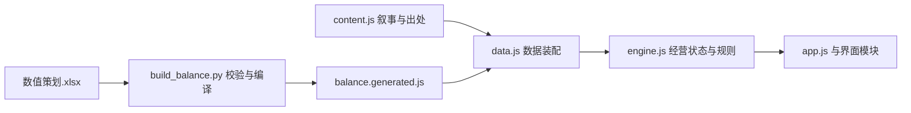

# 项目结构

运行时为本地 HTML、CSS、普通 JavaScript，没有框架、第三方运行依赖或网络请求。开发命令使用 Node.js 与 Python 标准库。

## 数据流

- `design/数值策划.xlsx`：所有可调经营数值和市场、公告、商路的数值关系。输入为原生数值，没有公式缓存依赖。
- `scripts/build_balance.py`：读取 XLSX、检查引用/范围/¼精度/开局装载，创建真实引擎新旅程验证，最后原子替换编译结果。`--check`只检查是否过期。
- `js/balance.generated.js`：离线运行用数据快照，保留在项目中。版本摘要来自规范化数值，不受表格样式或说明文字影响。
- `js/content.js`：人物、城镇与商品叙述、公告发布人及需求理由、原作出处、主线解锁关系、插图配置，以及世界事件的名称、范围与适用商品。其导出主体保持 JSON 字面量，编译器可用标准库读取。
- `js/data.js`：以稳定ID合并内容和数值；填充公告数量、货物名及主线数量等模板，派生供货城镇。不拥有平衡数值。

## 经营逻辑

`js/engine.js` 不依赖 DOM，负责交易、公告发布周期、批次货舱、时间、利息、腐坏、世界事件、消息、主线和存读档。界面通过其操作方法修改状态，不在点击处理器中直接改账簿。

世界事件由保存的 PRNG 状态逐日排定，先存在于世界中，未来消息再通过酒馆或旅人获悉。查询消息、行情和日历不会抽取新事件。事件保存类型、目标、商品、起止日与分层消息记录；效果倍率来自数值表，可信对白模板来自内容文件。`getKnownEvents()` 返回公开生效的全球事件和已获悉的未来消息；初闻视图不含准确日期、商品及倍率。`getActiveEvents()` 直接提供当前全球事件，不要求打听。只有公开或详细消息计入具体日历与行程预估。

事件开始、初次听闻和后续补充细节会写入持久通知队列，保存当时安全视图与对白。界面逐条调用 `getEventNotices()`、`acknowledgeEventNotice()`，暂停动画和逐日推进等待确认；刷新、导入和回退先恢复通知，再继续在途行程。纯引擎的同步时间操作不依赖DOM或弹窗。

旅行使用 `startTravel()`、`advanceTravelDay()`、`getTravelStatus()`：引擎按日推进世界并结算实际速度，界面只播放每日结果与沿路位置。`state.journey` 保存出发点、目标、已行里程、经过天数和已付旅费；刷新后恢复，不重复扣费。同步 `travel()` 同样逐日调用引擎，供无界面行为测试使用。旅行中不能执行城镇经营操作，`advanceDays()` 也不能绕过在途进度。事件规则见 [random-events.md](random-events.md)。

`js/money.js` 统一银币¼舍入与显示。`js/calendar.js` 将连续旅程天数换算为表内配置的行商历。

承重只存在于 `state.wagon.maxWeight`。公告只保存当前发布周期和成交记录，不保存领单状态。没有隐藏的旧委托、远期合同或多货币系统。

## 界面

- `js/app.js`：地图主界面、统一资讯（事件/消息/公告/成交）、配图消息确认、抽屉导航、交易交互、旅行演出和保存入口。PC顶部为日期、银币与旅程导航，右下为当前城镇与设施；700px及以下采用顶部状态、底部资讯/马车/存档/更多、全宽内容面板和商品卡片。地图相机按实际地图区域计算窄屏视野，跨断点重新定位；窄屏不显示鼠标行情浮窗。城镇和市场页的“收购公告”tab直接展示当地公告。
- `js/story-ui.js`：独立视觉小说阅读器，页面自己指定 `image` 和 `imageCaption`，不按中文标题匹配剧情。
- `js/cargo-ui.js`：格子货舱的展示、选择与拖动。
- `js/goods-catalog.js`：悬浮/键盘/点击固定的商品图鉴。
- `js/calendar-ui.js`：全图公告日程。
- `js/map-art.js`、`js/icons.js`：地图渲染、地理锚点与当前图标。马车两帧图片与说明由 `content.js` 的 `mapWagonArt` 维护，CSS以一秒周期交替透明度，各显示500ms，减少动态效果时保留第一帧；没有逐帧JS定时器或经营状态字段。

CSS按主界面、货舱、日历、图鉴分文件。主样式已整理为多行，保持有效规则顺序。

## 保存与发行

存档包含结构版本和数值摘要，均匹配才读入。没有迁移层。自动存档按当前结构版本命名；不同浏览器/地址之间通过本版文件存档转移。

`npm run package` 先执行验证再打包；`scripts/package.py` 按当前入口与资源引用收集清单，纳入策划表和开发文档，排除原作书库、缓存、旧ZIP。发行包不是数值或源码的维护源。
